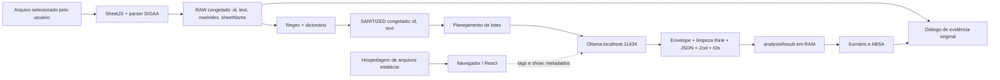

# 01 — Visão geral e arquitetura

[Índice](README.md) · [Estrutura](02-ESTRUTURA-E-FLUXOS.md) · [Achados](09-NAO-CONFORMIDADES.md)

## Objetivo, alcance e tecnologia

A Avalia é uma prova de conceito para importar respostas abertas de avaliações institucionais, mascarar padrões identificadores, analisar os textos com modelo local e consultar sínteses/classificações junto às evidências originais. O produto ajuda a explorar comentários; não mede por si só desempenho de professores ou alunos nem valida a veracidade de uma conclusão.

O escopo observado contém uma página, uma planilha por sessão, primeira aba, formatos tabular e SIGAA/UFC, higienização configurável, análise local e duas abas de resultados. Não há contas, histórico, colaboração, exportação de resultados ou recuperação de sessão. Não foram encontrados requisitos exigindo essas funcionalidades.

Versões instaladas: Next.js 16.4.0, React/React DOM 19.3.0, TypeScript 5.9.3, Tailwind/PostCSS 4.3.3/8.5.30, SheetJS 0.20.3, Zod 3.25.76 e zod-to-json-schema 3.25.2. Runtime da auditoria: Node 24.14.0, npm 11.9.0, Ollama 0.33.3. Todas as dependências diretas estão no [documento 07](07-DEPENDENCIAS-E-CONFIGURACOES.md).

## Arquitetura efetiva

O serviço Ollama é um processo externo local. Portanto, “100% client-side” descreve o processamento e estado da **aplicação web**, não significa que inferência acontece dentro do navegador. Também existe um servidor de arquivos para entregar o frontend; ele não é backend de negócio.

`app/page.tsx:1,20–148` concentra coordenação e estado. `next.config.ts:3–8` exige exportação estática. `app/layout.tsx` é executável durante a geração da página, mas não contém lógica de usuário, acesso a dados ou Server Action. Não há handler de API, ORM ou banco na árvore inspecionada. O build em V06 produziu apenas `/` e `/_not-found` estáticas; V07 serviu o artefato sem Next.

“Stateless” neste projeto significa **sem persistência de dados de aplicação entre sessões**. A interface possui estado React e referências durante o uso. A coleta de lixo do JavaScript não é apagamento criptográfico; arquivos originais, memória do processo Ollama, caches do ambiente e extensões ficam fora dessa garantia.

## Camadas e fronteiras

| Camada | Implementação | Garantia e limite |
| --- | --- | --- |
| Apresentação | `components/*.tsx`, `app/page.tsx` | Texto React, controles nativos, estados de erro; sem acesso direto ao disco |
| Importação | `lib/xlsxParser.ts`, `lib/sigaaParser.ts` | Preserva valores textuais e coordenadas; formatos explicitamente reconhecidos |
| Higienização | `lib/sanitize.ts` | Função pura, cópias congeladas; reconhecimento por regras, não anonimização universal |
| Contrato | `lib/schema.ts`, `types/index.ts` | Tipagem e validação estrutural; não verifica semântica |
| Integração | `lib/ollama.ts`, `lib/ollamaConnection.ts` | Fetch local, timeout, aborto, validações; depende do serviço e origem permitida |
| Projeção de resultados | `lib/results.ts`, `ResultsPanel` | Filtra/deduplica classificações e busca RAW por ID; não corrige a IA |

A fronteira RAW/SANITIZED é lógica e por referência, não isolamento de processo. Ambas as coleções estão acessíveis ao mesmo JavaScript da página. O chamador correto é `app/page.tsx:92`; o serviço recebe somente SANITIZED. A validação estrita rejeita objetos RAW com metadados, mas não comprova a origem de um objeto arbitrário `{id,text}` (P05). Não se constatou envio de RAW no fluxo atual.

## Decisões arquiteturais

| Decisão e evidência | Motivo verificável / avaliação | Alternativa e balanço |
| --- | --- | --- |
| Next com `output: "export"` — `next.config.ts:4` | Exigência expressa de ARCHITECTURE/AGENTS, atendida pelo build | SPA mais simples reduziria superfície de framework. Migrar agora sem necessidade quebraria a base exigida; manter é proporcional ao contrato, embora haja funcionalidades Next não usadas |
| React state local — `app/page.tsx:21–37` | Adequado a uma única sessão e ausência de persistência | Store global/Redux não agrega valor demonstrado. Um hook de coordenação poderia reduzir a página quando houver crescimento, sem nova biblioteca |
| RAW imutável + projeção SANITIZED — parser `:73–82`, sanitize `:53–57` | Rastreabilidade e preservação explícitas em PRIVACY | Mutação no mesmo array violaria requisito. Duplica referências/strings tratadas e aumenta memória; congelamento é barato para objetos rasos atuais |
| IDs iguais às linhas — `types/index.ts:3–8` | Facilita retornar à planilha, inclusive lacunas | UUID não necessário para uma importação. ID deixa de identificar o mesmo conteúdo se linhas forem inseridas, outro arquivo carregado ou múltiplas abas forem combinadas |
| SheetJS carregado após seleção — `app/page.tsx:135` | Leitura de XLS e XLSX local; carga adiada observável | CSV apenas reduziria dependência, mas perderia requisito XLS. Web Worker reduziria bloqueio da UI; não implementado |
| Regex e dicionário — `lib/sanitize.ts:21–57` | Explicitamente pedido; determinístico, sem biblioteca/IA | Detector de entidades ampliaria alcance com custo e erros próprios. Não indicado adicioná-lo sem requisito; corrigir equivalência Unicode e esclarecer cobertura primeiro |
| Schema Zod com conversor — `lib/schema.ts`, `lib/ollama.ts:79,85` | Contrato fornecido exige essa fonte de verdade | JSON Schema escrito à mão duplicaria enumerações/tipos. Zod 4 com conversão nativa é alternativa futura, não substituição automática do contrato |
| Fetch centralizado — `ollamaConnection.ts:12–48` | Mesmos controles para tags/show/generate, erros seguros e limpeza de timers | Três Fetch independentes duplicariam aborto/timeout. SDK não é necessário e contrariaria o pedido de Fetch direto |
| Lotes sequenciais e resultado atômico — `ollama.ts:44–58,82–107` | Controla tamanho/contexto e evita sucesso parcial; justificativa operacional, não requisito original detalhado | Paralelismo sobrecarregaria modelo local; retomada parcial aumentaria estado. Limites fixos precisam de medição; uma falha perde todos os lotes |
| Síntese por concatenação — `ollama.ts:102` | Mantém evidências e evita segunda inferência | Sumário global poderia reduzir redundância, mas adicionaria custo e nova chance de erro. Não há critério original verificável de tamanho/globalidade |
| Dashboard nativo — `ResultsPanel.tsx:95–140` | Filtros, tabela e gráfico simples sem dependências extras | Biblioteca de gráficos seria excessiva para três barras; manter controles nativos é proporcional |
| Tags selecionáveis e alias `latest` — `ollamaConnection.ts:3,55–60` | Lista local existe no plano atual; pedido anterior exemplificava modelo fixo | Flexibilidade ajuda operação, mas prejudica experimento fixo. Digest, versão e protocolo precisam ser congelados para avaliação científica (`AUD-05`) |

Não há evidência histórica suficiente para atribuir todas essas escolhas a decisões deliberadas do autor. A tabela distingue exigências escritas de avaliação de proporcionalidade.

## Tratamento de erros e confiança

Importação inválida zera as coleções antes de iniciar e mostra erro; tentativa de seleção com extensão/tamanho inválidos conserva o arquivo anterior. Modelos indisponíveis desabilitam análise. Requisições têm prazo e aborto. JSON inválido, schema inválido, ID fora do lote e saída truncada rejeitam a análise inteira. Alterações de arquivo/configuração/modelo invalidam resultados em andamento.

Zod assegura formato e enums, não factualidade. A citação permite revisão; não demonstra que o modelo interpretou corretamente. O contrato permite listas externas vazias e textos vazios. Não foram adicionadas restrições novas nesta auditoria. Veja `AUD-03`, `AUD-04` e o [inventário](03-INVENTARIO-DE-FUNCIONALIDADES.md).
