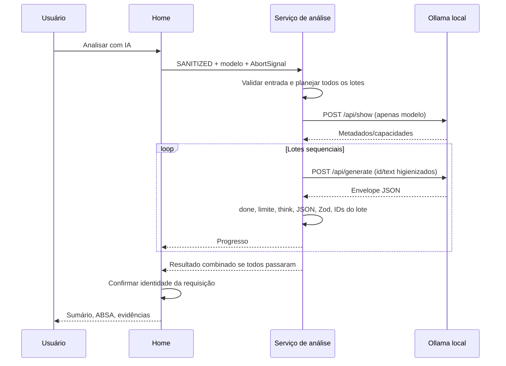

# 02 — Estrutura e fluxos

[Índice](README.md) · [Arquitetura](01-VISAO-GERAL-E-ARQUITETURA.md) · [Testes](08-TESTES-E-VALIDACOES.md)

## Inventário dos 38 arquivos preexistentes

Diretórios gerados `.next/`, `out/` e `node_modules/` foram examinados quanto ao resultado das ferramentas, não revisados linha a linha como código autoral. Não havia arquivos de CI, backend, migração, serviço de banco, `.env` de aplicação ou outros módulos de produto no inventário.

| Arquivo(s) | Responsabilidade e ponto de entrada |
| --- | --- |
| `AGENTS.md` | Cinco restrições para implementação; linhas 3–7 |
| `PLAN.md` | Plano atual em cinco fases; linhas 3–11 |
| `README.md` | Execução, uso, limites, dependências e verificação |
| `docs/ARCHITECTURE.md` | Arquitetura e interface, linhas 3–14 |
| `docs/PRIVACY.md` | Mascaramento, separação e citações, linhas 3–13 |
| `docs/AI_CONTRACT.md` | Schema normativo, payload, thinking e IDs |
| `docs/VALIDATION.md` | Registro histórico de verificações e limitações; não é suíte executável |
| `app/layout.tsx` | HTML `pt-BR`, metadados e CSS; `RootLayout`, linha 10 |
| `app/page.tsx` | Estado, transições e composição visual; `Home`, linha 20 |
| `app/globals.css` | Tailwind, fontes locais, cores e foco; linhas 1–33 |
| `components/UploadArea.tsx` | Seleção, drag-and-drop, validação preliminar, remoção; linha 20 |
| `components/SanitizationPanel.tsx` | Configuração e amostra RAW/SAN; linhas 6, 25 |
| `components/AnalysisPanel.tsx` | Modelo, disparo/cancelamento, progresso e feedback; linha 19 |
| `components/ResultsPanel.tsx` | Abas, filtros, gráfico, paginação e `EvidenceDialog`; linhas 17, 41 |
| `lib/importLimits.ts` | Constantes de tamanho/dimensões e `validateFileSize`, linha 7 |
| `lib/xlsxParser.ts` | `extractRawComments`, linha 16; `parseXlsxFile`, linha 86 |
| `lib/sigaaParser.ts` | Máquina de estados do relatório SIGAA; `extractSigaaComments`, linha 17 |
| `lib/sanitize.ts` | `sanitizeComments`, linha 21; regex/dicionário/imutabilidade |
| `lib/schema.ts` | `AnalysisResultSchema`, linha 4; tipo inferido, linha 34 |
| `lib/ollamaConnection.ts` | Transporte, enumeração e verificação do serviço; linhas 12, 55, 63 |
| `lib/ollama.ts` | Limpeza, validação, lotes e inferência; linhas 23, 44, 67 |
| `lib/results.ts` | Enumerações derivadas e projeções ABSA; linhas 3, 11, 21, 25 |
| `types/index.ts` | `RawComment`, linha 2; `SanitizedComment`, linha 12 |
| `tests/xlsxParser.test.mjs` | 10 testes de parser tabular/arquivo/limites |
| `tests/sigaaParser.test.mjs` | 13 testes de estrutura SIGAA, XLS/XLSX e metadados |
| `tests/sanitize.test.mjs` | 14 testes de regras, imutabilidade e integração parser/higienização |
| `tests/ollama.test.mjs` | 20 testes de contrato, transporte simulado, lotes e falhas |
| `tests/ollamaConnection.test.mjs` | 5 testes de descoberta, capacidades, erros e aborto |
| `tests/results.test.mjs` | 1 teste com múltiplas asserções de projeção/contagem/filtros |
| `tests/fixtures/comentarios.xlsx` | Fixture sintética com três respostas nas linhas 2, 4 e 6 |
| `package.json`, `package-lock.json` | Scripts, requisitos e resolução exata das dependências |
| `next.config.ts` | Exportação estática, Strict Mode e preservação de AGENTS |
| `next-env.d.ts` | Referências geradas de tipos Next; não editar manualmente |
| `tsconfig.json` | TypeScript estrito, resolução bundler, aliases, noEmit |
| `eslint.config.mjs` | Regras Next/TypeScript e exclusões de gerados |
| `postcss.config.mjs` | Plugin Tailwind para PostCSS |
| `.gitignore` | Exclusão de dependências, builds, env e logs; não cria repositório Git |

## Modelo de dados

```typescript
interface RawComment {
  readonly id: number;         // linha física, base 1
  readonly text: string;       // conteúdo textual preservado
  readonly rowIndex: number;
  readonly sheetName: string;
}
interface SanitizedComment {
  readonly id: number;
  readonly text: string;
}
```

Os dois arrays e seus objetos são congelados no runtime. As strings são imutáveis em JavaScript. Isso não impede outro código de criar novas projeções, acessar ambas as coleções ou usar um texto original; a garantia depende também dos chamadores.

`AnalysisResult` é inferido de `lib/schema.ts`. Cada ponto do sumário contém `text` e `evidenceIds`; cada entrada ABSA contém `commentId` e `aspects[]` com `aspect` e `sentiment`. Não há campo de disciplina, respondente, confiança, versão do modelo ou evidência textual delimitada. Não inferir esses dados da estrutura atual.

## Fluxo de importação e higienização

1. `UploadArea.selectFile` (`:29`) aceita um arquivo, extensão `.xls/.xlsx`, tamanho não vazio até 10 MiB. Erro nessa etapa conserva a seleção anterior.
2. `Home.handleFileSelect` (`app/page.tsx:121`) aborta análise, incrementa `importVersion`, limpa RAW/SAN e importa o parser dinamicamente.
3. `parseXlsxFile` usa `File.arrayBuffer()` e SheetJS `read` (`lib/xlsxParser.ts:97–105`). Primeira aba; fórmulas são mantidas no objeto para poder rejeitá-las na extração.
4. Dimensões são validadas **depois** da decodificação. Limites: coordenadas dentro de 50.000 linhas e 256 colunas, retângulo até 500.000 posições. `!fullref` evita aceitar truncamento silencioso.
5. Primeira linha preenchida deve conter uma coluna de comentários; se não contiver, tenta-se assinatura SIGAA/UFC. Não há detecção genérica de qualquer relatório.
6. No formato tabular, são capturadas células textuais não vazias. Fórmulas, erros e valores não textuais geram erro. Espaços, quebras de linha e duplicatas permanecem.
7. No SIGAA, A identifica blocos; B contém disciplina, rótulos ou ordinais; C contém respostas. Respostas docentes e discentes são reunidas. Não se preserva associação à disciplina no tipo final.
8. Após resolver o parser, uma versão antiga de importação é ignorada. A configuração mais recente, obtida de `settingsRef`, gera SANITIZED. RAW nunca é sobrescrito.
9. Editar configuração executa a higienização novamente, sincronamente, e invalida a análise anterior (`app/page.tsx:112–118`).

## Fluxo de análise



O payload usa JSON Schema, `stream:false`, `think:false`, `temperature:0`, contexto 8.192 e saída até 2.048 tokens. Lotes: oito comentários e 3.000 unidades de comprimento da string JSON; não são 3.000 tokens nem necessariamente 3.000 bytes. Comentário individual excedente causa recusa integral antes de enviar comentários.

`requestOllama` fixa origem, omite credenciais, proíbe redirects, usa `no-store`, limita tags/show a 10 segundos e generate a cinco minutos. Não há retry automático. Limpar o timeout e remover o listener no `finally` evita retenção desnecessária. A interrupção do Fetch não comprova encerramento imediato do processamento no processo Ollama.

`parseAnalysisResponse` remove `<think>` antes do JSON.parse e novamente no texto já decodificado, rejeitando tags incompletas. Zod descarta campos desconhecidos. Os IDs são validados contra **o lote enviado**, e não apenas a planilha. Um envelope `done:true` com listas vazias é aceito pelo contrato.

## Estados e transições relevantes

| Estado/referência | Função | Transição/garantia |
| --- | --- | --- |
| `rawComments`, `sanitizedComments` | Coleções da sessão | Nova seleção zera ambas; configuração só substitui SAN |
| `sanitizationSettings`, `settingsRef` | Dicionário e regra | Ref fornece última configuração à leitura pendente |
| `readStatus`, `readError` | idle/loading/success/error | Zero comentários é sucesso de leitura, sem análise habilitada |
| `importVersion` | Controle de corrida | Resposta de arquivo substituído/removido é ignorada |
| `analysisRequest` | AbortController corrente | Identidade da referência impede sucesso/erro de requisição antiga |
| `analysisResult`, `analysisError`, `isAnalyzing`, `progress` | Análise atual | `invalidateAnalysis` limpa tudo e aborta Fetch |
| `models`, `model`, `modelsLoading`, `modelRefresh` | Seleção local | Effect com aborto na limpeza; mudança de modelo invalida resultados |
| `selectedFile` no UploadArea | Referência File | Conservada até troca/remoção/desmontagem |
| `previewId` | Amostra RAW/SAN | Busca ID; se ausente, mostra primeiro comentário |
| Aba/filtros/página/evidência em ResultsPanel | Navegação local | Filtro reinicia página; citação consulta mapa de RAW |

Remover arquivo limpa comentários/resultados e a referência ao File. **O dicionário de nomes e a regra permanecem**, assim como modelo/configuração, até recarregar/fechar (`AUD-10`). Recarregar não apaga o arquivo de origem do computador. O servidor estático entrega código e assets; não recebe a planilha.

## Resultados e acessibilidade observável

`classificationRows` remove tuplas id/aspecto/sentimento repetidas. Sentimentos distintos do mesmo aspecto permanecem; não há consenso automático. Gráfico e filtros usam as mesmas linhas. A tabela exibe 25 por página; o sumário não é paginado. `rawById` permite consulta de evidência sem rede.

Existem rótulos de formulário, regiões de status/alerta, abas com setas/Home/End, foco visível, texto alternativo às barras e diálogo nativo modal. O teste atual confirmou abertura inicial, idioma e ausência de overflow desktop; a interação completa e a área de celular constam apenas no registro histórico. Não há certificação de acessibilidade ou teste em todos os navegadores.
